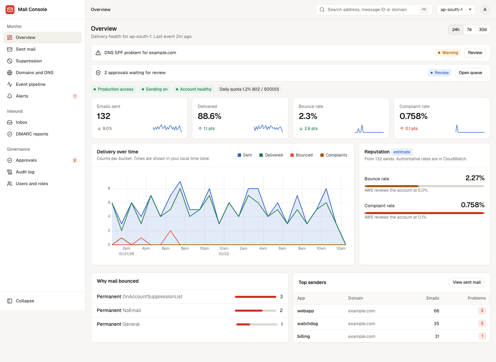
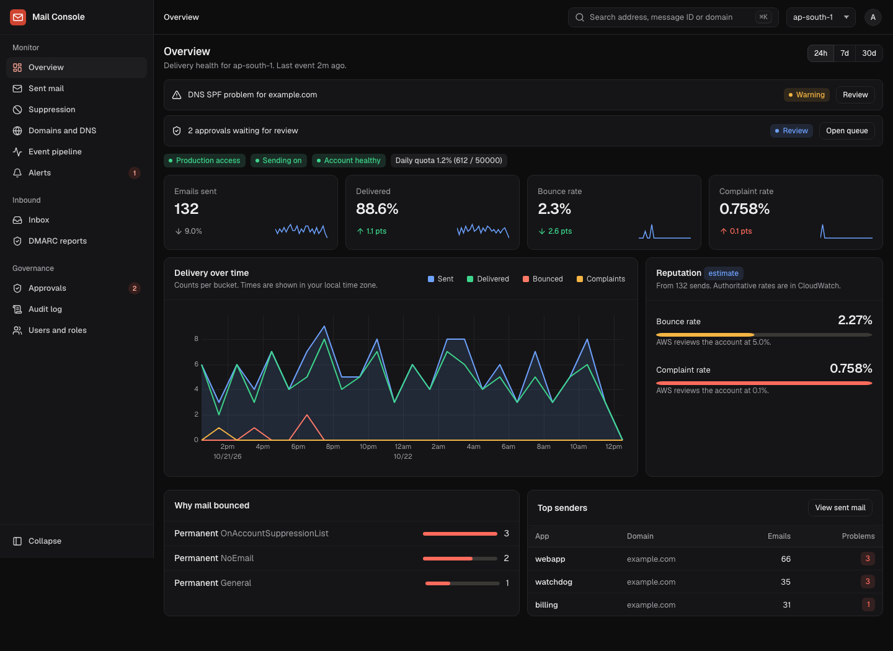
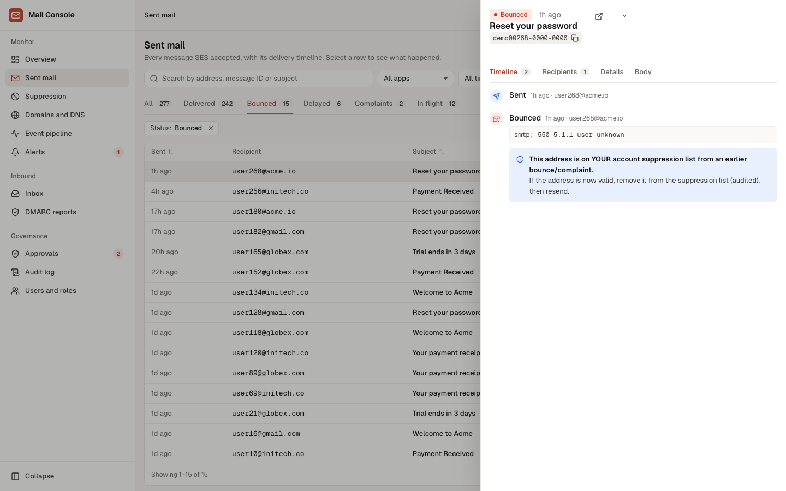
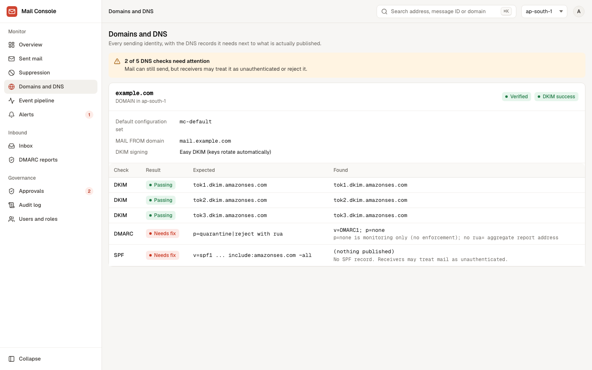
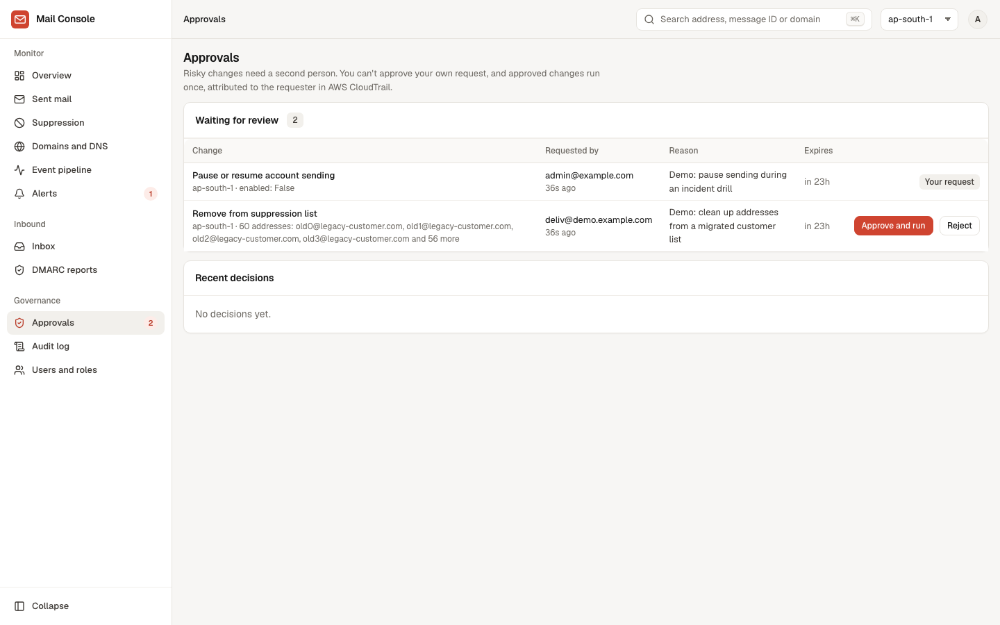
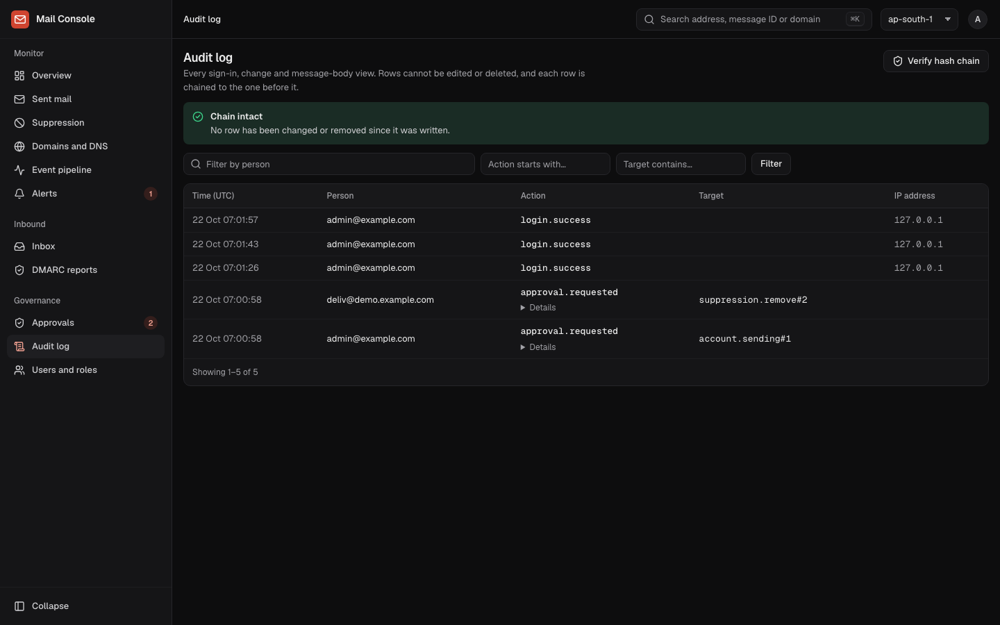

# Mail Console

A secure management and monitoring console for Amazon SES. See what happened to every email, fix deliverability
problems, and change SES settings safely, without opening the AWS console. Django 5.2 + HTMX, PostgreSQL 16, no Node
toolchain.

  
  

## What it does
- **Sent mail:** every message SES accepted, with its delivery timeline. Bounces come with a plain-language explanation
  and what to do next.
- **Suppression list:** search it, remove a single address with a passkey check, or remove many through an approval.
- **Domains and DNS:** each sending identity next to the DKIM, SPF and DMARC records it needs, expected against found.
- **Alerts:** DNS problems, enforcement or sending paused, and no events arriving.
- **Safe changes:** every change to SES asks for a passkey, and risky ones (bulk suppression removal, pausing sending,
  identity and event-destination changes) also need a second person to approve. Changes run with narrowly scoped AWS
  roles that can never send mail (Compose, below, is an opt-in exception with its own narrow role).
- **Estimated cost:** SES message charges this month and for the selected period, by sender app. It is a floor, not your bill: each
  recipient counts as one email at `MC_SES_PRICE_PER_1000` (default `0.10`), and attachment data charges, any free tier,
  Virtual Deliverability Manager and dedicated IPs are not visible to the console.
- **DMARC reports:** have them collected from a reports address (opt-in, `aws/README.md` section 9) or upload the attachments
  mailbox providers send (`.xml`, `.gz` or `.zip`), and see,
  per domain, the pass rate over 7, 30 or 90 days, who is sending as your domain, and whether it looks safe to move from
  `p=none` to enforcement (needs at least a week of reports and 100 messages, and at most 2% failing). Uploads are validated
  strictly, kept as numbers only (with the file's fingerprint), and labelled unverified; a report that later arrives by mail
  replaces its uploaded copy in the counts. Mailed reports are only counted when SES's virus and DMARC checks of the sender
  passed and within size limits; reports from providers you list are verified, any other sender's are labelled unverified;
  daily allowances are kept per pool so strangers cannot crowd out your providers; everything turned away is listed with its reason.
- **Tamper-evident audit log:** every sign-in, change and message-body view, hash-chained so edits show.

  
  

  
  

The screenshots use synthetic demo data. Project status and known gaps: [docs/STATUS.md](docs/STATUS.md).

## Try it (demo with synthetic data)
    docker compose up --build
    # then open http://localhost:8000/dev-login/?email=admin@example.com

This starts the console and PostgreSQL with made-up mail data. It runs in a development mode with a sign-in shortcut
and is bound to `127.0.0.1`: it is for looking around, never for a real deployment (see `SECURITY.md`).

## Connect it to your AWS account
`aws/README.md` has the few CLI commands and the IAM policy files you need: an SNS topic and SQS queue that receive SES
events, and three roles (read-only, plus two narrow write roles) that can never send mail (plus an optional send role for Compose, `aws/README.md` section 8). There is no hosting stack to
apply: run the container on any small server. The steps have been applied to a real production account and checked there.

## Local development
    python3 -m venv .venv && .venv/bin/pip install -r requirements-dev.txt
    # throwaway Postgres on :54329 (see config/test_settings.py), then:
    .venv/bin/python -m pytest

Run locally (DEBUG only; dev login is refused unless DEBUG is on):
    MC_DEBUG=1 MC_DEV_LOGIN=1 MC_SECRET_KEY=dev MC_DB_PORT=54329 .venv/bin/python manage.py runserver
    manage.py create_console_user you@example.com --role security_admin

Never `source` env files; configuration comes from environment variables (`config/settings.py`, prefix `MC_`).

## Components
- `apps/sesdata`: events parser, state machine, ingest worker, SES sync, DNS checks, metrics, alerts, AWS facade
- `apps/approvals`: four-eyes workflow; `apps/audit`: hash-chained audit log; `apps/accounts`: SSO, passkeys, sessions
- `apps/inbound`: MIME parsing, sanitizer, redaction, mailview renderer; `apps/console`: pages
- `aws/`: the AWS setup as CLI steps and IAM policy files (`aws/README.md`); `scripts/phase0_audit.py`: read-only AWS audit

## Sign-in
Any OpenID Connect provider with a discovery URL works (Google, Okta, Microsoft Entra, Keycloak, Authentik...):
`MC_OIDC_DISCOVERY_URL`, `MC_OIDC_CLIENT_ID`, `MC_OIDC_CLIENT_SECRET`, `MC_OIDC_PROVIDER_NAME` (button label).

- **Domain policy is required.** Set `MC_OIDC_ALLOWED_DOMAIN` to your organisation's e-mail domain (with Google the `hd`
  claim must match too), or set `MC_OIDC_ALLOW_ANY_DOMAIN=1` to accept any verified address on purpose. Without one of
  them the app refuses to start in production.
- **People must be provisioned**: a security admin adds them under *Users and roles, Add a person* (passkey, audited; the address must be on `MC_OIDC_ALLOWED_DOMAIN` if set), or with `manage.py create_console_user`. The e-mail only selects the account: the first
  sign-in binds the provider's stable issuer and subject to it, and every later sign-in must present the same pair, or it
  is refused and audited (`login.identity_mismatch`). Have each person sign in soon after you add them, and reset a
  binding with `create_console_user --reset-identity`.
- **Strict claims.** `email_verified` must be true. Microsoft Entra does not send it by default, so sign-in fails closed
  until you configure it. Use a tenant-specific discovery URL: multi-tenant endpoints (templated issuer) are refused.
- Changes to SES additionally ask for a passkey.

## Limiting a person to some domains
A person can be limited to some From-domains (set when you add them). It narrows what they see; it is **not** a tenant boundary.

- **Covered:** the sent-mail list and details, search, domains and DNS, the overview's top senders, provider breakdown and
  cost estimate, alerts (account-level ones and their own domains' DNS alerts; per-app alerts and any unrecognised kind are
  hidden), and the suppression list, its history, its CSV export and removals (only addresses their own domains mailed).
- **Not covered:** the audit log, the approvals queue, the inbox and DMARC reports, the overview's account-wide totals and charts,
  the event pipeline page, the From addresses offered by Compose, and the Prometheus endpoint. Give a limited person a role
  without access to these (a viewer sees none of the first three), and do not rely on scope to keep one brand's data from
  another brand's administrators. For that, run separate consoles.

## Compose (optional)
Write and send a one-off message from an address you own, without leaving the console. Off unless `MC_SEND_ENABLED=1` (setup in
`aws/README.md`, section 8). It is for one-off mail, not campaigns: no lists, no attachments, no scheduling.

- **Who and from where:** deliverability and security admins. Each address must be in `MC_SEND_FROM_ADDRESSES`, allowed by the
  AWS send role, and switched on by a security admin under Sending addresses.
- **Every send needs a passkey**, is attributed to the person in the audit log and in AWS CloudTrail, and goes through your
  configuration set so it appears in Sent mail with its delivery timeline. The audit log records who, from, how many and the
  message id, never the body.
- **The text of mail sent by other applications (opt-in, `aws/README.md` section 10):** point an SES Mail Manager archive at the
  configuration sets you want to read, and admins can open a message's text from the Body tab, with a reason and a passkey check, audited.
  Links and codes are redacted and only the last `MC_ARCHIVE_VIEW_DAYS` days are shown. The archive holds the full text in AWS for its
  retention period (at least three months), so attach it only to mail you are prepared to keep that way.
- **A permanent copy in a mailbox (opt-in, `aws/README.md` section 11):** a worker copies every archived message into a Google Workspace
  mailbox (Gmail API, insert only: nothing is sent), under a label per sending address and outside the Inbox, so the mail can be searched like
  any other and kept for as long as the mailbox is. The credential can only insert mail and manage labels. The copy is unredacted.
- **The text of what was sent (off by default):** set `MC_SEND_KEEP_BODY_DAYS` (for example `90`) and Compose keeps the plain text
  the author wrote, plus the Reply-To, for that many days; after that the text is blanked and the rest of the record stays. A
  deliverability or security admin opens it from the **Body** tab of the message in Sent mail, with a reason and a passkey check, and
  every opening is audited (the reason, never the text). It is shown, never rendered. Only Compose mail is covered: SES does not
  give the console the content of mail sent by other applications. Database backups hold the text for as long as they are kept.
- **Guardrails:** per-message, per-person and per-day recipient limits, plus an optional daily limit for each From address (set under
  Sending addresses, counted across everyone, so a sensitive address like a payments one can have a low ceiling of its own); recipients on the SES suppression list are refused; line
  breaks in addresses or subjects are refused; what is sent is exactly what was previewed; a draft can only be sent once.
- **If AWS gives no clear answer** (a timeout), the message is marked "may have been sent" and is not offered for re-sending until
  someone checks Sent mail and says it did not go out. The send client never retries automatically, so a lost response cannot
  mail the same message twice.
- Plain text only. The HTML part is the same text, escaped, with `http(s)` links made clickable.
- **Templates:** a shared library of reusable messages with `{{first_name}}`-style placeholders. Using one asks for each value and
  creates an ordinary draft (nothing is sent from there); a message with an unfilled placeholder cannot be previewed or sent.
  Anyone who can compose can use and create templates; only the creator or a security admin can edit or delete one, and every
  change is audited (name and placeholders, never the text).

## Alerts
Alerts always appear on the Alerts page. To get them elsewhere, set a channel (https only):

| Setting | Meaning |
|---|---|
| `MC_ALERT_SLACK_WEBHOOK_URL` | a Slack incoming webhook |
| `MC_ALERT_WEBHOOK_URL`, `MC_ALERT_WEBHOOK_SECRET` | any tool that accepts a JSON `POST`; the secret is optional and signs each request |
| `MC_ALERT_QUIET_HOURS`, `MC_ALERT_QUIET_TZ` | for example `22:00-07:00` and `Asia/Kolkata`: warnings wait until the window ends, urgent alerts never do |
| `MC_ALERT_NOTIFY_RESOLVED` | send a notice when an alert resolves (default on) |

What opens an alert (all values are fractions; the Alerts page shows what is in force):

| Setting | Default | Meaning |
|---|---|---|
| `MC_ALERT_BOUNCE_WARN` / `_PAGE` | `0.02` / `0.04` | bounce rate warning / urgent (SES starts reviewing at about 5%) |
| `MC_ALERT_COMPLAINT_WARN` / `_PAGE` | `0.0005` / `0.0008` | complaint rate (SES starts reviewing at about 0.1%) |
| `MC_ALERT_MIN_SAMPLE`, `MC_ALERT_APP_MIN_SAMPLE` | `200`, `50` | sends in 24 hours needed before a rate alerts, account-wide and per sender app |
| `MC_ALERT_QUOTA_WARN` | `0.80` | share of the daily quota used |
| `MC_ALERT_SILENT_MIN_MINUTES`, `_GAP_FACTOR`, `_MAX_HOURS` | `60`, `3`, `24` | "no events" waits at least the minimum, and at least the factor times the usual gap between sends, capped |

Bounce and complaint rates are also checked per sender app (the `mc-app` tag on your messages), so one app with a bad
list is named instead of hiding in the account average. A config set with fewer than 3 sends in a week is never reported silent.

**Verifying the webhook.** With a secret set, each request has `X-Mail-Console-Timestamp` (unix seconds) and
`X-Mail-Console-Signature: sha256=<hex>`, the HMAC-SHA256 of `"<timestamp>." + raw body` keyed with the secret:

    import hashlib, hmac, time
    def valid(secret: bytes, body: bytes, ts: str, sig: str) -> bool:
        good = "sha256=" + hmac.new(secret, ts.encode() + b"." + body, hashlib.sha256).hexdigest()
        return hmac.compare_digest(good, sig) and abs(time.time() - int(ts)) < 300   # also rejects replays

The body is `{"event": "alert.firing" | "alert.resolved" | "test", "alert": {id, key, severity, title, detail, opened_at, resolved_at}, ...}`.
The Alerts page has a button that sends a test notification to every channel.

## Metrics (Prometheus)
`GET /metrics` serves Prometheus text format. It does not exist (404) until you set `MC_METRICS_TOKEN` (at least 32
characters; `python -c "import secrets; print(secrets.token_urlsafe(32))"`), and then it needs
`Authorization: Bearer <token>`. A signed-in session is not accepted, and neither is a token in the URL.

    scrape_configs:
      - job_name: mail-console
        scheme: https
        metrics_path: /metrics
        authorization: {credentials_file: /etc/prometheus/mail-console.token}
        static_configs: [{targets: ["console.example.com"]}]

It reports aggregate numbers only (no addresses, subjects or message ids), and every label is a small bounded set
(sender apps are capped at the busiest 50). Numbers come from the console's own database and are cached for 10 seconds.

| Metric | Labels | Meaning |
|---|---|---|
| `mailconsole_events_24h` | `event_type` | SES events received in the last 24 hours |
| `mailconsole_app_events_24h` | `app`, `event_type` | the same by sender app (`send`, `delivery`, `bounce`, `complaint`) |
| `mailconsole_reputation_bounce_rate_24h`, `_complaint_rate_`, `_sample_` | | the console's own estimate; CloudWatch is authoritative |
| `mailconsole_ses_sending_enabled`, `_production_access`, `_enforcement_healthy`, `_quota_used_ratio`, `_sent_24h`, `_max_24h_send` | `region` | account state as of the last sync |
| `mailconsole_last_event_timestamp_seconds`, `mailconsole_last_sync_timestamp_seconds` | `region` (sync) | for "nothing arrived for a while" rules |
| `mailconsole_suppression_entries` | `region` | addresses on the suppression list |
| `mailconsole_alerts_open` | `severity` | open alerts |
| `mailconsole_approvals_pending` | | changes waiting for a second person |

Per-app ratios are best computed in PromQL, where you choose the window. Note these are plain counts, so unlike the
console's estimate they include transient bounces:

    sum by (app) (mailconsole_app_events_24h{event_type="bounce"})
      / sum by (app) (mailconsole_app_events_24h{event_type="send"})

    # example alert rules
    - alert: MailConsoleSyncStalled
      expr: time() - mailconsole_last_sync_timestamp_seconds > 900
    - alert: SesNotHealthy
      expr: mailconsole_ses_enforcement_healthy == 0 or mailconsole_ses_sending_enabled == 0

## Appearance
A security admin can give the console its own look under *Appearance* (passkey, audited; no approver, since nothing in AWS
changes): product name, logo, a logo for the dark theme, favicon, accent colour, default theme and table density, a line
beside the sign-in form and a footer line. A preview shows the result before saving, and *Reset to default* restores the
original look. Uploads are PNG or SVG (a favicon may also be ICO), at most 512 KB and 1024 by 1024 pixels, stored in the
database and checked by their content: an SVG is accepted only if it contains plain shapes and paths, with no script, link,
text, image, filter, DOCTYPE or editor extras, and a refused file is never edited. The accent must keep white button text
at 4.5:1. The `MC_BRAND_*` settings remain the defaults used wherever nothing has been set in the console. The footer shows on
console pages only; mail you send is never changed.

## License
Licensed under the [Apache License 2.0](LICENSE). Third-party components are listed in
[THIRD_PARTY_NOTICES.md](THIRD_PARTY_NOTICES.md). The name, logo and accent colour are configurable in
*Settings > Appearance* or with the `MC_BRAND_*` settings. Contributions are accepted under the same licence with a DCO sign-off (see
[CONTRIBUTING.md](CONTRIBUTING.md)).
